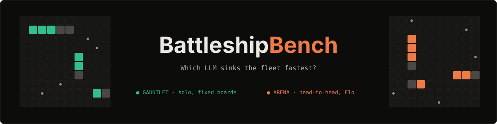

<p align="center"></p>

<p align="center">
  <code>Battleship 10x10</code> · <code>metric: shots to win</code> · <code>rating: Elo (K=32)</code> · <code>0 dependencies</code>
</p>

**BattleshipBench** measures how well language models play Battleship: spatial reasoning, keeping a board in mind, following a strict output format, and adapting after every hit or miss. Each turn the model sees only its own shot history and answers with one JSON move. No tools, no hand-holding.

## Leaderboard

<!-- LEADERBOARD:START -->
### 🎯 Gauntlet (solo, fixed boards, 0-100)

| # | Model | Score | Avg shots | Boards | Auto-moves |
|--:|---|--:|--:|--:|--:|
| 1 | unsloth/Qwen3.6-35B-A3B-GGUF:UD-Q4_K_M | **66.3** | 45 | 3 | 0 |
| 2 | 🤖 Probability bot | **37.8** | 68.7 | 3 | 0 |
| 3 | 🤖 Random bot | **2.4** | 98 | 3 | 0 |

### ⚔️ Arena (head-to-head, Elo)

_No games played yet._
<!-- LEADERBOARD:END -->

## How the scores work

### 🎯 Gauntlet: absolute score, 0–100

Every model plays **solo** on the *same* 3 seeded boards (same fleet positions for everyone), so results are reproducible and independent of any opponent.

```
score = 100 × (100 − average shots to sink the fleet) / 83
```

| Score | Meaning |
|--:|---|
| **100** | Perfect play: 17 shots, every shot a hit |
| **~38** | The probability-density bot on these boards (a strong algorithmic baseline) |
| **~2** | Random shooting (about 98 shots) |
| **0** | Fleet not sunk within 100 shots |

Invalid moves (off-board, already-fired cell, no JSON) get two retries with feedback; after that a random *auto-move* is played and counted. Bots (🤖) are the yardstick.

Every model gets the same helper prompt: the rules, a short hunt/target strategy, and a board where finished ships are marked `S`, open hits `X`, plus the list of unresolved hits and the smallest remaining ship. Thinking is capped at 5000 tokens per move, the same for every model, only as a guard against endless loops (a cut-off model must answer from what it has, and a repetition detector stops looping earlier).

### 🗺️ How the boards are made: difficult, but realistic

All models play the same first 3 of the 10 boards frozen in [`boards.json`](boards.json), so results are comparable and reproducible. The Gauntlet score is always computed on those 3 boards, bots included.

1. **Realistic:** standard fleet (Carrier 5, Battleship 4, Cruiser 3, Submarine 3, Destroyer 2); ships are straight and never overlap, may touch; mixed orientation (2–3 horizontal); at most 2 ships flush against the border.
2. **Difficult:** for each board, 300 random legal fleets are generated and each is played 3× by the probability-density bot. The fleet that bot needs the most shots to find is kept. These fleets sit where density heuristics look last, so lucky center-hunting does not pay off.
3. **Transparent:** regenerate with `node bench.mjs boards`. The live screen shows every ship by name so you can follow how each model hunts.

Caveat: boards are tuned against the density bot, which makes the bot a *harsh* yardstick. Compare models to each other and to the bots on the same boards.

### ⚔️ Arena: relative score, Elo

Two models play each other, each one placing its own fleet. Every finished game updates an **Elo** rating (start 1000, K = 32): beating a stronger model earns more than beating a weaker one. Swap sides across games to cancel out the first-move advantage. Also tracked per model: win rate, average shots per win, accuracy (hits / shots) and auto-moves.

## Run it

```bash
node server.mjs                                              # 1v1 arena at http://127.0.0.1:8791, live bench at /bench
node bench.mjs boards                                        # (re)generate the fixed boards
node bench.mjs bots                                          # measure the yardstick bots
node bench.mjs run anthropic/claude-haiku-5-5 --boards 3     # Gauntlet for one model
node bench.mjs readme                                        # refresh the leaderboard above
```

Add providers (OpenAI-compatible endpoints or Anthropic) with the **Providers** button. API keys stay in `providers.json` on your machine (mode 600, git-ignored). See `providers.example.json`. Results live in `bench.jsonl` (Gauntlet) and `matches.jsonl` (Arena).
